  <a href="https://github.com/OWooody/Snag"><b>Snag</b></a> ·
  <a href="https://github.com/OWooody/wafeq-mcp">wafeq-mcp</a> ·
  <a href="https://github.com/OWooody/make-me-an-app-template">make-me-an-app-template</a> ·
  <a href="https://github.com/OWooody/OssAPISwift">OssAPISwift</a>

<picture>
  <source media="(prefers-color-scheme: dark)" srcset="https://raw.githubusercontent.com/OWooody/OWooody/output/github-snake-dark.svg" />
  
</picture>
