<a href="https://owooody.github.io/OWooody/">
  <picture>
    <source media="(prefers-color-scheme: dark)" srcset="https://raw.githubusercontent.com/OWooody/OWooody/output/pacman-contribution-graph-dark.svg" />
    
  </picture>
</a>

  <a href="https://owooody.github.io/OWooody/"><b>&#9654; PLAY IT</b></a> &#8212; Pac-Man on my contribution graph, arrow keys or swipe

  <a href="https://github.com/OWooody/Snag"><b>Snag</b></a> &#183;
  <a href="https://github.com/OWooody/wafeq-mcp">wafeq-mcp</a> &#183;
  <a href="https://github.com/OWooody/make-me-an-app-template">make-me-an-app-template</a> &#183;
  <a href="https://github.com/OWooody/OssAPISwift">OssAPISwift</a>

